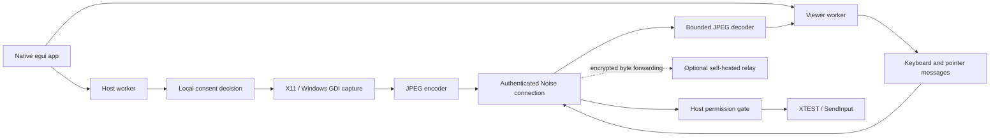

# Architecture and protocol

## Scope

The reference investigation explains documented AnyDesk behavior and static observations from shipped artifacts. This document describes our independent engineering choices. None of the module names or message definitions below are asserted to be AnyDesk internals.

## Ownership

- `app.rs` owns native UI state, consent prompts, worker cancellation and socket shutdown handles. It retains only the latest pending frame. Expensive capture, encoding and network work run outside the UI thread.
- `transport.rs` owns the TCP socket, Noise handshake and ordered cipher state. A failed authentication, frame, decode or I/O operation closes and poisons the connection.
- `protocol.rs` owns application message definitions, version and image/input limits.
- `session.rs` owns host authorization enforcement, screen encoding/decoding and session cleanup. A desktop adapter is constructed only after the host accepts. A release guard cleans held input on any exit from a serving session.
- `platform/` owns OS capture, pixel conversion, input mapping and the set of held buttons/keys. Native capture allocations use the same dimension validator as incoming frames.
- `relay.rs` owns waiting rooms, paired sockets, forwarding workers and stop cleanup. It forwards ciphertext without sharing endpoint cipher state.

## Connection sequence

1. The host explicitly starts sharing and generates a fresh random 32-byte pairing secret. Direct mode binds the chosen local address; relay mode makes an outbound connection instead.
2. In relay mode, both peers send a role and a SHA-256 room digest derived with domain separation from the secret. The relay acknowledges the matched pair and becomes a byte forwarder. Those routing fields are observable metadata.
3. The viewer and host complete `Noise_NNpsk0_25519_ChaChaPoly_BLAKE2s`. The prologue binds the handshake to this application's transport version. Possession of the full pairing secret is required; the secret is never sent in plaintext or as a protocol field.
4. The viewer sends `Hello { version, name, request_control }` inside the encrypted channel.
5. The host displays the name as an untrusted caller-provided label, plus the actual network peer or relay description. Host approval is independent of encryption and secret possession.
6. A declined/expired request receives `Rejected`. Approval returns `Accepted { version, control }`. Both sides shorten network deadlines after approval.
7. The viewer sends bounded `Poll` requests. The host rejects input in view-only sessions, handles explicit releases, then captures a frame at its own rate limit.
8. A changed frame produces `Frame { sequence, width, height, jpeg }`; an identical captured buffer produces `Unchanged`.
9. Escape, local focus loss or a saturated input queue requests release of all session-held inputs. Explicit remote shortcuts first release previous inputs and then send a balanced key chord in that poll; they never transfer clipboard contents. An explicit disconnect or socket failure ends the session. Stopping/closing the host shuts down its active socket and listener worker.

## Framing

Application messages are serialized with Postcard. The message enum order is part of protocol version 1; changing it requires a version change.

Each message starts with an AEAD-protected record containing its four-byte total serialized length. It is followed by ordered encrypted fragments of at most 60 KiB plaintext each. An outer two-byte big-endian record length delimits ciphertext; it is bounded before allocation. Modifying a ciphertext boundary fails authentication. The full message length is authenticated and capped at 16 MiB before aggregate allocation. Trailing serialized bytes and incomplete messages are rejected.

The JPEG header must match the declared dimensions. Width, height, total pixels, compressed bytes and decoder allocation limits are checked independently. A changed desktop geometry is sent with the next frame.

## Platform behavior

Linux reads X11 TrueColor pixels, honors byte order, color masks and row padding, and converts to RGBA8. The prototype uses `GetImage`; it does not yet use the XDamage/shared-memory path observed statically in AnyDesk. XTEST key/button/motion messages are generated only within a control-approved session. The first keyboard map group is used.

Windows captures the primary screen with `BitBlt` into a top-down DIB, calls `GdiFlush` before reading DIB memory, and converts BGRA to RGBA. GDI resources have owned cleanup. `SendInput` is subject to Windows integrity-level and secure-desktop restrictions. The program does not elevate privileges. References: [CreateDIBSection](https://learn.microsoft.com/en-us/windows/win32/api/wingdi/nf-wingdi-createdibsection), [SendInput](https://learn.microsoft.com/en-us/windows/win32/api/winuser/nf-winuser-sendinput).

Both adapters validate remote pointer bounds and wheel magnitude, track their own held inputs, and attempt releases on disconnect. The current protocol represents Latin keys rather than arbitrary Unicode text, and it does not transport the host's cursor shape.

## Verification boundaries

Loopback tests establish actual use of our encryption/framing, synthetic screen streaming, permission gates, relay and disconnect behavior. Pixel/mapping tests establish conversion logic. A local capture check establishes Zorin X11 capture and JPEG round-trip on this host. Windows cross-compilation establishes type/API compatibility with the Windows target, not Windows runtime correctness.

The prototype has no automatic traversal/fallback, persistent identity or account service. The relay's admission policy is bounded but deliberately simple and not hardened for a hostile public service. These remain explicit implementation limits rather than inferred AnyDesk limitations.
