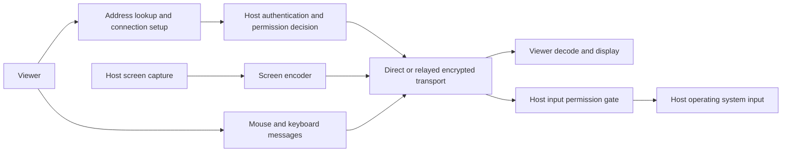

# AnyDesk investigation

This is a bounded investigation of AnyDesk for building an independent Rust remote desktop for Windows and Linux. It combines vendor documentation with static inspection of downloaded application artifacts. It is not a recovered implementation of DeskRT or AnyDesk's wire protocol, and it establishes no interoperability with AnyDesk clients or servers.

## Evidence and execution boundary

The official download pages, support documentation, package index, and shipped files are the evidence sources. Downloaded executables are kept under the ignored `artifacts/` directory for local inspection. They are not installed or executed. No AnyDesk service is started, no live connection is made, and no traffic or credentials are captured.

REA's `reverse-engineer-anything` workflow was consulted. REA tools are not connected in this chat, the checkout has no installed dependencies or built runtime, and its Node requirement is not met by existing Node 24.12.0 or 20.20.2. Its package declares `^22.23.4 || ^24.22.1 || >=26.12.1`. No Hopper, Ghidra, IDA, or Rizin engine was found on PATH. No prerequisites or agent registrations were changed. Consequently, local findings below come from ordinary static file tools, not REA Evidence records or decompiler output.

Local evidence IDs in this report are investigator labels. They are not REA Evidence IDs.

## What the public behavior establishes

| Question | Answer and evidence type | Evidence |
| --- | --- | --- |
| How do devices find each other? | Vendor documented: each client has a persistent numeric address, normally 9 or 10 digits, and can have an alias. The private directory and rendezvous messages remain unknown. | DOC-01: [ID and alias](https://support.anydesk.com/docs/anydesk-id-and-alias) |
| How does data travel? | Vendor documented: direct connections are optional and use TCP 7070 by default. Disabling direct connections routes sessions through AnyDesk servers. The vendor states session data remains end-to-end encrypted in either mode. | DOC-02: [Connection settings](https://support.anydesk.com/docs/settings#connection) |
| Which other ports matter? | Vendor documented: TCP 80, 443, or 6568 provide network connectivity. UDP 50001–50003 and multicast 239.255.102.18 are for local discovery. This does not establish that remote video uses those UDP ports. | DOC-03: [Firewall configuration](https://support.anydesk.com/docs/firewall) |
| What happens before control starts? | Vendor documented: attended requests can require local acceptance; unattended access uses credentials. A screen-sharing permission profile permits viewing without control. Input, clipboard, files, audio, and other actions have separate permissions. | DOC-04: [Permission profiles](https://support.anydesk.com/docs/setting-up-permission-profiles), DOC-02: [Access settings](https://support.anydesk.com/docs/settings#security) |
| How are pixels compressed? | Vendor documented: DeskRT is a proprietary codec intended for computer graphics. Its packet format, transforms, change detection, and rate-control algorithms have not been recovered. Marketing performance figures are not measurements from this investigation. | DOC-05: [Official technical description](https://anydesk.com/en/ai-info), DOC-06: [Performance](https://www.anydesk.com/en/performance) |
| Which cryptography is documented now? | Vendor documented: the security article updated October 19, 2026 specifies TLS 1.3 and AEAD. It also describes salted password tokens, two-factor authentication, and access-control lists. This is not an observed handshake or independent crypto audit. | DOC-07: [Security](https://support.anydesk.com/docs/security-tips) |
| What does Linux require? | Vendor documented: receiving an incoming session requires an Xorg graphical session. A Wayland client can initiate outgoing sessions. Zorin is not in the vendor's explicit support list. | DOC-08: [Linux requirements](https://support.anydesk.com/docs/anydesk-for-linux-raspberry-pi) |

## Static artifact observations

The Linux package identifies itself as **8.1.1 amd64**. Its 16,821,162 bytes hash to `133defb9d4902f3659025e9fa3d5847a663988a2c2faacbfe18b6b3fb188a737`, matching the SHA-256 in the official HTTPS package index. This comparison does not independently verify the repository signature. The extracted executable is ELF64 x86-64, 44,557,112 bytes, SHA-256 `af499dc7091cda1b6ce8235be83d6c904cfc20034c83df2f77192e27e88e0015`. See [artifact identity](artifact-manifest.json).

| Local finding | What it establishes | Limit |
| --- | --- | --- |
| SHELL-01: X11 capture declarations | The dynamic table declares X11, XCB shared-memory, XDamage, XFixes, RandR, and XTest dependencies. Undefined function declarations include `xcb_shm_get_image`, `XDamageCreate`, `XDamageSubtract`, and `XFixesGetCursorImage`. | Declarations alone do not establish runtime use. |
| SHELL-02: capture call sites | Disassembly contains direct calls to `XDamageCreate` at `0x58ceb6`, `XDamageSubtract` at `0x58d06d`, and `xcb_shm_get_image` at `0x590117` and `0x5903b1`. A cursor-image call appears at `0xa528e7`. | These support an X11 damage/shared-memory/cursor capture path. Which session takes that path and its change-merging policy are unobserved. |
| SHELL-03: input wrappers | The shipped ELF declares `XTestFakeKeyEvent`, `XTestFakeButtonEvent`, and `XTestFakeMotionEvent`. Tail jumps to their PLT entries occur at `0x9c44a9`, `0x9c44b9`, and `0x9c44c7`, respectively. | These establish static XTest wrappers; input policy checks and actual injection were not observed. |
| SHELL-04: network and security literals | The executable contains `ad.anynet.boot_addrs=boot.net.anydesk.com`, direct/listen configuration keys, permission-profile keys, `TLSv1.3`, and standard TLS 1.3 cipher-suite names. | A literal is not proof of a connection, a negotiated cipher, or correct authorization enforcement. |
| SHELL-05: Wayland dependency | `libwayland-client.so.0` and `wl_display_connect` are declared. | This does not contradict the vendor's incoming-session limitation and does not establish Wayland capture support. |

The Windows download is **9.8.4**, confirmed by its UTF-16 version resource and fixed VERSIONINFO fields. Its 8,554,424 bytes hash to `3f5a98b1a162ae3b3adf07df38cd554943e79919ff4ae90b44f392959887da22`. The outer image is PE32/i386. Its declared import-directory RVA and size are zero; it has an uninitialized `.itext` region, a small `.text`, a large `.data`, and a `win_loader` PDB path. This is consistent with a loader/embedded payload, but the payload was not recovered and no specific packer was identified. The absence of outer import entries cannot establish that Windows capture or input APIs are absent. Authenticode was not verified. See [Windows artifact identity](windows-artifact-manifest.json).

The import, string-offset, and selected call-site records are linked in [the evidence ledger](evidence-ledger.json). Full raw tool output remains in ignored `artifacts/`; no disassembler database was opened or modified.

## Architecture inferred from those facts

An implementation needs separable identity/rendezvous, authentication and local authorization, transport, screen capture/encoding, display/decoding, and reverse-direction input handling. These are functional deductions from the documented features, not names recovered from AnyDesk's source.

The distinction between encryption and consent is important to the design: a successfully encrypted connection alone does not authorize screen capture or input. The host must authorize capabilities for each session and be able to end that session.

For our implementation, use an independent documented protocol and standard maintained cryptographic libraries. Screen encoding and transport should be replaceable so a simple tested first codec can later be replaced by a low-latency video path. These are our engineering choices, not claims about AnyDesk internals.

## Remaining questions

- The proprietary DeskRT bitstream and exact image-change, quality, buffering, and adaptation algorithms are unresolved.
- Private registration, peer discovery, NAT traversal, relay framing, identity binding, and credential derivation are unresolved.
- Runtime ordering, actual negotiated cryptographic parameters, bandwidth, latency, CPU use, and failure recovery were not observed.
- Imports or embedded strings can establish that bytes or API declarations are present. They do not establish which execution path uses them or that a security property is enforced.
- Windows and Linux behavior need separate runtime tests on owned test devices. Static inspection on Linux cannot verify Windows permissions, UAC behavior, drivers, or capture performance.

The artifact identity, local tool outputs, and exact static findings are recorded in `artifact-manifest.json` and `evidence-ledger.json` alongside this report.
